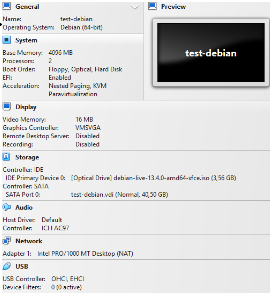
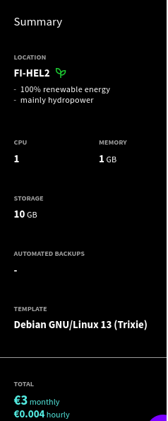
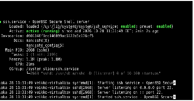
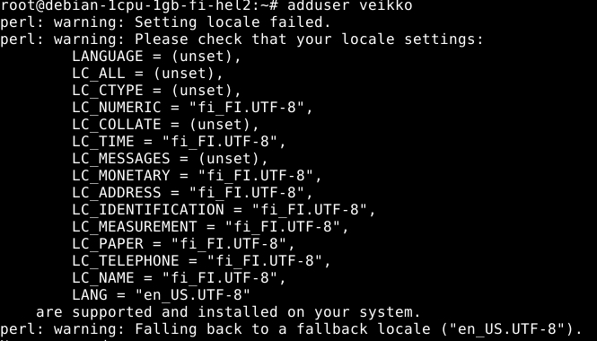
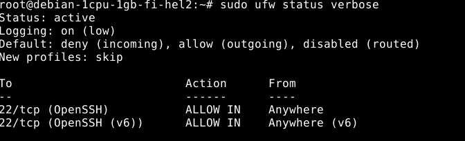

## X)

Artikkelissa Niemi 2025 H4 tehtävät käydään läpi virtuaalipalvelimen vuokraus UpCloud palvelun kautta ja etäyhteyden muodostamista SSH-protokollalla (Secure Shell). Tehtävä suoritettiin Linux-Debian käyttöjärjestelmällä käyttäen komentoterminaalin syötettäviä komentoja.

Artikkeli Partanen 2025 käsittelee myös virtuaalipalvelimen vuokrausta tällä kertaa Namecheap palvelun kautta. Palvelimen DNS-tietueen voimassaoloaika (Time to live)  muutetaan viiteen minuuttiin ja aliaksena toimiva verkkotunnus poistetaan.

## A)

Asensin Debian-käyttöjärjestelmän VirtualBox ohjelman kautta, jossa on 40 gigatavua levytilaa, neljä gigatavua muistia ja kaksi prosessorin ydintä. 

## B)

Vuokrasin nimipalvelimen UpCloud palvelusta. Valitsin sivuston sijainniksi Suomen, koska yhteys on nopeampi ja palvelinkeskus toimii uusiutuvalla energialla. Palvelimen laitteistoasetuksiin otin yhden prosessori ytimen, yksi gigatavu muistia ja kymmenen gigatavua levytilaa. Opettaja suositteli tätä vaihtoehtoa tunnilla, koska tavalliset verkkopalvelimet eivät tarvitse paljon tehoa. Käyttöjärjestelmäksi valitsin Debian-13. Palvelin kulut ovat noin kolme euroa kuukaudessa. 

Alla on yhteenveto tiedoista:

## C)

Verkkopalvelua varten tarvitaan SSH-protokolla (Secure Shell) etäyhteydenpitoa varten. Asennetaan OpenSSH paketti komentoterminaalista käyttäyen komentoja (sudo apt update) ja sudo apt install openssh-server. SSH toimivuus tarkistetaan sudo systemctl status ssh komennolla.

Sivustoon luodaan yhteys komennolla ssh root@85.9.223.249. Palvelin päivitetään (apt update) ja (apt install sudo ufw) komennoilla. Viimeiseksi käyttäjä lisätään komennolla (adduser veikko). Palomuuri asetetaan komennoilla (sudo ufw default deny incoming) ja (sudo ufw default allow outgoing) ja sitten laitetaan päälle (sudo ufw enable). 

