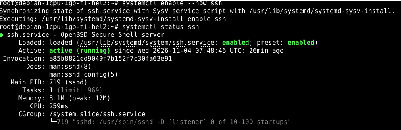
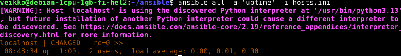
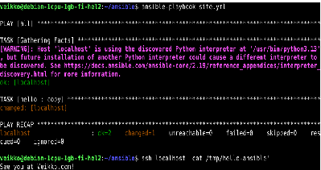

# Hei ansiblen maailma

## X) 

Artikkeli SSH public key käsittelee secure shell verkkoprotokollan asennusta. Protokolla asennetaan käyttämällä Linux-komentorivin kautta pakettina. Asennuksen jälkeen laaditaan uusi avain etäyhteyttä varten.

Artikkelissa Hello Ansible käsitellään Ansible nimisen ohjelmiston asennusta. Ohjelmistoa käytetään hallitsemaan monta laitetta SSH-etäyhteyden kautta. Ansiblea varten tarvitaan konfigurointi tiedostot hallittavista tietokoneista ja niiden rooleista. 

## A)

Asensin Debian-käyttöjärjestelmän VirtualBox ohjelman kautta, jossa on 40 gigatavua levytilaa, neljä gigatavua muistia ja kaksi prosessorin ydintä. 

## B)

Ensin kirjaudutaan palvelimelle root-käyttäjällä ja asennetaan openssh-server komennolla (apt install openssh-server). SSH-ohjelmisto käynnistetään komennolla (systemctl enable --now ssh). Palvelun tilan voi tarkistaa komennolla (systemctl status ssh), joka antaa seuraavan tulosteen.

Yhteys muodostetaan komennolla (ssh veikko@localhost). 

## C)

Kirjaudutaan palvelimelle omalla käyttäjällä, tässä tapauksessa "veikko". Luodaan SSH-avain komennolla (ssh-keygen -t ed25519) ja kopioidaan luotu avain tiedostoon authorized_keys komennolla (cat ~/.ssh/id_ed25519.pub >> ~/.ssh/authorized_keys). Komento cat lukee tiedoston id_ed25519.pub sisällön ja operaattori ">>" ohjaa sen tiedoston authorized_keys loppuun. 

## D)

Asennetaan ansible ohjelmisto komennolla (sudo apt-get install ansible micro bash-completion tree). Seuraavaksi luodaan kansio komennolla (mkdir ~/ansible) ja luodaan tiedosto hosts.ini sen sisälle käyttäen juuri asennettua micro-editor ohjelmistoa komennolla (micro hosts.ini). Lisätään merkkijono "localhost" tiedostoon. Kokeillaan ansible-ohjelman toimivuutta komennolla (ansible all -a 'uptime' -i hosts-ini). Komento antaa seuraavan tulosteen:

Luodaan konfigurointi tiedosto ansible.cfg, jotta voimme suorittaa komentoja käyttäen tiedostoa hosts.ini oletusarvona. Luodaan tiedosto taas komennolla (micro ansible.cfg) ja lisätään merkkijonot: 

[defaults] 
inventory = hosts.ini

Nyt voimme käyttää komentoa (ansible all -a 'uptime') mainitsematta hosts.ini tiedostoa. 

Luodaan seuraavaksi site.yml tiedosto, jonka tarkoitus on jakaa rooleja eri tietokoneille. Luodaan tiedosto komennolla (micro site.yml) ja lisätään merkkijonot: 

- hosts: all
  roles:
    - hello

Tämä tarvitsee vielä kansiorakenteen lisätylle roolille "hello". Luodaan kansio komennolla (mkdir -p roles/hello/tasks/). Luodaan tiedosto main.yml kansioon /roles/hello/tasks/main.yml ja kopioidaan merkkijonot:

- copy:
  dest: /tmp/hello-ansible
  content: "See you at Veikko.com!\n"

Testataan komentoa (ansible-playbook site.yml). Komento suorittaa tehtävät tietokoneilla, jotka määrittelimme tiedostoon hosts.ini. Kokeillaan vielä tulostaa tiedoston hello-ansible sisältö päätteeseen käyttäyen ssh localhost yhteyttä komennolla (ssh localhost 'cat /tmp/hello-ansible'). 

Lisätään lopuksi tulostus komentopäätteeseen, joka mainitsee tehtävässä käytetyt argumentit. Siirrytään tiedostoon ansible.cfg ja lisätään merkkijono "display_args_to_stdout = true". Nyt komento (ansible-playbook site.yml) tulostaa hello roolin main.yml tiedoston sisällön. 

## Lähteet

Karvinen, T. Palvelinten hallinta. Luettavissa: https://terokarvinen.com/palvelinten-hallinta/#laksyt Luettu 27.10.2026

Karvinen, T. hello-ansible. Luettavissa: https://terokarvinen.com/hello-ansible/ Luettu 03.11.2026

UpCloud Global Cloud Platform - UpCloud. Luettavissa: https://upcloud.com/ Luettu 27.10.2026
