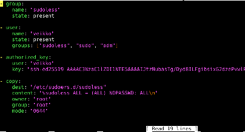
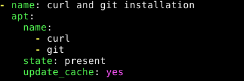
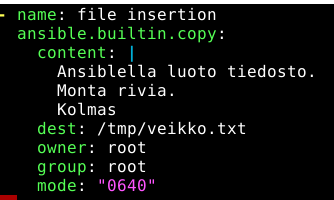

# H2 Voileipä 

## X)

Sudo without password - Artikkelissa luodaan käyttäjäryhmä "sudoless". Ryhmälle annetaan oikeus suorittaa komentoja ilman salasanan käyttämistä. 

XKCD 149: Sandwich - Sivustossa näkyy sarjakuva, joka kertoo vitsin sudo-komennon käyttämisestä Linux-ympäristössä. Komennot vaativat riittävän korkeat käyttöoikeudet.

Passwordless Sudo with Ansible - Artikkelissa luodaan Ansible roolille antero "sudoless" ryhmä, joka voi suorittaa komentoja ilman salasanaa. Ansiblessa tarvitaan kuitenkin salasana ensimmäisellä kirjatumisella.

Ansible copy - Copy komento kopio tiedoston tai hakemiston kohdetietokoneesta toiselle palvelimelle. Parametri "content" asettaaa tiedoston arvon määriteltyyn arvoon. Parametri "dest" määrittää tiedoston polun, mihin se kopioidaan. Parametri "src" on tiedoston polku, josta kopioidaan toiselle palvelimelle. Parametri "owner" määrittää käyttäjän, jonka pitäisi omistaa tiedosto. Parametri "group" määrittää ryhmän, joka tulee omistamaan tiedostojärjestelmän objektin. Parametri "mode" asettaa tiedoston tai hakemiston lupa-asetukset (chmod 644, u+rwx).

## A)

Luodaan aluksi ryhmä "sudoless" komennolla (sudo groupadd sudoless). Tämän jälkeen lisätään edellisessä tehtävässä luotu käyttäjä "veikko" ryhmään komennolla (sudo adduser veikko sudoless). 

## B)

Luodaan rooli veikko ja lisätään main.yml tiedosto hakemistoon /ansible/roles/veikko/tasks/main.yml. Lisätään seuraava merkkijono main.yml tiedoston sisään:

  

## C)

Asennetaan curl ja git ohjelmistot. Siirrytään main.yml tiedostoon hakemistossa /ansible/roles/veikko/tasks/main.yml ja lisätään merkkijonot:

 

Komento ansible-playbook asentaa nyt curl ja git ohjelmistot.

## D)

Luodaan taas uusi komento main.yml tiedoston sisälle merkkijonoilla:

  

Oikeus 0600 antaa luku- ja kirjoitusoikeudet. 

## Lähteet

Karvinen, T. Palvelinten hallinta. Luettavissa: https://terokarvinen.com/palvelinten-hallinta/#laksyt Luettu 27.10.2026

UpCloud Global Cloud Platform - UpCloud. Luettavissa: https://upcloud.com/ Luettu 27.10.2026
