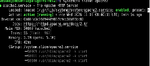

# Demoni

## X)

Apache installed with Ansible - Artikkelissa asennetaan Apache2 web-palvelin, joka lisätään rooliksi Ansible ohjelmistoa varten. Rooleja varten luodaan oma Ansible tehtävä konfiguraatiotiedostoon (main.yml).

Handlers: running operations on change - Sivuston ohjeistus näyttää miten luodaan "käsittelijä" Ansible ohjelmistoa varten. Käsittelijä, eli handler suorittaa tehtävän, kun ohjelmistossa tapahtuu jonkinlainen muutos. Käsittelijän tehtävä lisätään taas konfiguraatiotiedostoon. Muutoksia varten on luotu avainsana "notify", joka merkitsee mitä käsittelijää suoritetaan tehtävän yhteydessä.

Ansible service module - Service moduuli hallinnoi etäpalvelimia. Parametri "enabled" arvo määrittää, käynnistyykö palvelu käyttöjärjestelmän kanssa. Parametri "name" arvo on palvelun käytettävä nimi. Parametri "state" määrittää palvelun tilan, jolla voi olla kolme mahdollista arvoa (started / stopped, restarted, reloaded). Examples osio näyttää miten luodaan tehtävä konfiguraatio sivustoon. Tehtävä vaatii nimen, käytettävän ansible moduulin, tässä tapauksessa (ansible.builtin.service) ja tilan (state). 

## Y)

Are Blockchains Decentralized - Lohkoketjujen on tarkoitus hajauttaa informaatio palvelimien välillä, jolloin millään järjestelmällä ei ole keskitettyä hallintaa järjestelmästä. Raportissa näytetään, miten lohkoketjuun voi saada keskitettyä valtaa murtamatta ketjun kryptografista varmennusta. Keskitetty hallinta ilmenee kolmessa eri kohdassa, ohjelmiston totetus, verkkoliikenteen keskittyminen ja verkon rakenne. Ohjelmisto käyttää kirjastoja, jotka sisältävät koodia kolmannelta osapuolelta, joka altistaa sen hyökkäysvektoreille. Ohjelmiston kehitys jää myös harvojen ihmisten käsiin, jolloin pienellä yhteisöllä voi olla merkittävä rooli järjestelmän toiminnan ylläpitämisessä. Lohkoketjut käyttävät myös internet-palveluntarjojia, jolloin verkkoliikenne kulkee keskitetyn ympäristön kautta. Palveluntarjoajilla voi ilmetä myös ongelmia heidän palveluissa, joka taas heikentää lohkoketjujen toimintaa. 

## A)

Asennetaan aluksi apache2 ohjelmisto palvelimelle komennoilla (sudo apt update, sudo apt install apache2). Update päivittää ohjelmistopaketit ja sen jälkeen asentaa apache2 ohjelmiston. Ohjelmiston tilaa voi tarkistaa komennolla (systemctl status apache2), joka antaa seuraavan tulosteen komentoterminaaliin:

## Lähteet

https://terokarvinen.com/palvelinten-hallinta/#laksyt

https://terokarvinen.com/apache-ansible/

https://assets-global.website-files.com/5fd11235b3950c2c1a3b6df4/62af6c641a672b3329b9a480_Unintended_Centralities_in_Distributed_Ledgers.pdf
